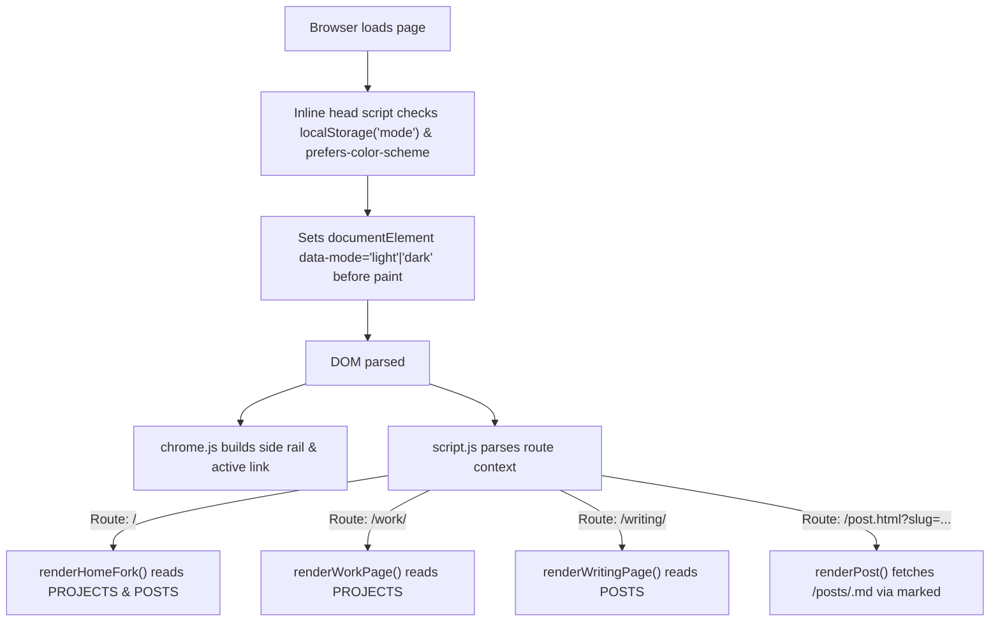

# Portfolio Redesign: Soft, Text-Led, Work/Writing Fork

* **Author:** tangerine0000 (Tan Nguyen)
* **Status:** Approved
* **Date:** 2026-10-29

--------------------------------------------------------------------------------

## Overview

Redesign the personal developer portfolio for Tan Nguyen (`tanport.netlify.app`) from a heavy risograph aesthetic (grain, halftone dots, heavy offset black shadows, 4-palette theme cycler) into a clean, modern, soft text-led portfolio and blog.

The primary audience is recruiters evaluating engineering capabilities, while supporting readers of a growing blog stream (short notes, essays, personal reflections). The landing page operates as a split fork ("show don't tell") dividing into Work and Writing paths.

## The Problem

The existing portfolio design suffers from:
1. **Visual weight & friction**: Heavy halftone dots, grain overlays, and dark offset borders feel cluttered and distracting rather than modern and focused.
2. **Ambiguous audience targeting**: Recruiters wanting immediate proof of work must navigate generic cards, while the blog lacks personal editorial typography for mixed short notes and longer essays.
3. **Overcomplicated themes vs. essential accessibility**: A 4-theme palette switcher creates maintenance overhead without providing a dedicated, standard dark mode or system preference detection.

The solution is an airy layout grounded in a soft peach-to-aqua wash, soft teal accents, dark mode support, a persistent monospace side-rail navigation, and an interactive, playful landing fork between Work and Writing.

## Goals

* **G1: Fresh visual identity**: Transition to a warm off-white canvas with a subtle top peach-to-aqua wash, clean hairlines, and soft teal highlights without boxes, cards, or shadows.
* **G2: Show-don't-tell landing fork**: Present an interactive split landing on desktop where hovering or focusing one path (Work or Writing) highlights it and softly dims the sibling, previewing real project and writing content.
* **G3: Dedicated shareable routes**: Establish `/work/` and `/writing/` as direct static routes with backwards compatibility for `/projects.html` and `/blog.html` via Netlify `_redirects`.
* **G4: Dark mode support**: Support light mode and warm charcoal-navy dark mode using an inline, pre-paint check to eliminate theme flashing.
* **G5: Structured manifests**: Separate project details into `projects.js` and extend `posts.js` with `kind` (`note` | `essay` | `personal`) and `lede` summary fields.

## Non-Goals

* **NG1: No "Museum" section**: Curated curios/cabinet features are out of scope for this iteration.
* **NG2: No framework or build step**: Retain pure static vanilla HTML/CSS/JS deployable directly to Netlify without Node or Webpack compilation steps.
* **NG3: No backend form handlers**: Remove the mock contact form in favor of direct email and social links.
* **NG4: No wiki rewrite**: The `docs/` codebase documentation will be kept functional with baseline styling but not fundamentally overhauled.

## Open Questions

* **Q1**: What are the exact project screenshot assets and live repo URLs to place in `projects.js`?
* **Q2**: Should heading typography use Space Grotesk (geometric/tech) or Manrope/Inter (softer/contemporary)?
* **Q3**: Will 2 additional placeholder markdown notes be added before launch to ensure the writing stream renders with balanced density?

## Critical User Journeys (CUJs)

### CUJ 1: Recruiter Direct Work Inspection
* **Given**: A recruiter receives a direct link (`tanport.netlify.app/work` or clicks "Work →" on the landing page).
* **When**: The recruiter lands on the page.
* **Then**: They immediately view a clean chronological list of key projects with stack metadata, live links, and concise architectural overviews without visual clutter.

### CUJ 2: Casual Reader Exploring the Writing Stream
* **Given**: A visitor enters the site landing page on desktop or mobile.
* **When**: They hover over or tap the "Writing →" split on desktop (or scroll down on mobile).
* **Then**: The writing side illuminates with real opening lines of essays and notes; clicking directs them to `/writing/` where posts are sorted chronologically and labeled by format (`essay`, `note`, `personal`).

### CUJ 3: Night-time Visitor Theme Toggle
* **Given**: A visitor with dark system preferences or requesting dark mode visits the site.
* **When**: The page loads or the visitor clicks the moon/sun icon in the side rail.
* **Then**: The page renders immediately in warm charcoal-navy with adjusted contrast levels and no white flash.

--------------------------------------------------------------------------------

## Technical Plan (Architecture)

### 1. System Structure & Layout

The site transitions from horizontal chrome injection to a responsive side-rail navigation layout (`chrome.js`).

```text
+-----------------------------------------------------------------------------------------+
|                                    tanport.netlify.app                                  |
+-------------------+---------------------------------------------------------------------+
| [Side-Rail Nav]   | [Main Content Area]                                                 |
|                   |                                                                     |
| tan nguyen        | Desktop:                                                            |
|                   |                                                                     |
| index             | +---------------------------------+-------------------------------+ |
| work              | | Work ->                         | Writing ->                    | |
| writing           | | (Peach ambient wash)            | (Aqua ambient wash)           | |
| about             | |                                 |                               | |
|                   | | - Featured Project snapshot     | - Pull-quote opening lede     | |
| [Theme Toggle]    | | - Stack info in monospace       | - Post date and kind tag      | |
| (Moon/Sun)        | | - Chronological hairline list   | - Editorial hairline entries  | |
|                   | +---------------------------------+-------------------------------+ |
| [Social Links]    |                                                                     |
| GitHub / LinkedIn | Mobile: Side rail transforms to top bar; Work and Writing stack.    |
+-------------------+---------------------------------------------------------------------+
```

### 2. Component Boundaries & Manifest Contracts

1. **`chrome.js` (Shared Shell)**:
   - Injects side rail with brand name, navigation links (`/`, `/work/`, `/writing/`, `/about/`), social links, and the light/dark mode button.
   - On viewports `< 768px`, renders as a compact sticky top bar.
   - Manages theme toggling via `data-mode="light|dark"` on `<html>`.

2. **`projects.js` (Work Manifest)**:
   - Exposes `const PROJECTS = [...]` with structure:
     `{ slug: string, title: string, year: string, stack: string[], summary: string, image?: string, link?: string, repo?: string }`.

3. **`posts.js` (Writing Manifest)**:
   - Extends existing `POSTS` array with:
     `{ slug: string, title: string, date: string, kind: 'note' | 'essay' | 'personal', lede: string, excerpt: string, tags?: string[], readMins?: number }`.

4. **`script.js` (Page Logic)**:
   - `renderHomeFork()`: Dynamically hydrates the landing page split view using entries from `PROJECTS` and `POSTS`.
   - `renderWorkPage()`: Renders the full project catalog on `/work/index.html`.
   - `renderWritingPage()`: Renders chronological list categorized by `kind` on `/writing/index.html`.
   - `renderPost()`: Retains Markdown fetching via `marked@12` on `post.html?slug=<slug>`.

### 3. Data Flow & Rendering Pipeline



### 4. Interactive CSS Fork Mechanism

The desktop landing page split uses CSS relational selectors and CSS custom properties:

```css
/* Container */
.fork-container {
  display: grid;
  grid-template-columns: 1fr 1fr;
  position: relative;
}

/* Sibling dimming when hovering */
.fork-container:has(.fork-half:hover) .fork-half:not(:hover),
.fork-container:has(.fork-half:focus-within) .fork-half:not(:focus-within) {
  opacity: 0.45;
  filter: grayscale(0.4);
  transition: opacity 0.3s ease, filter 0.3s ease;
}

.fork-half:hover,
.fork-half:focus-within {
  transform: translateY(-2px);
  transition: transform 0.3s ease;
}

@media (max-width: 768px) {
  .fork-container {
    grid-template-columns: 1fr;
  }
}
```

--------------------------------------------------------------------------------

## Alternatives Considered

### Alternative A: Soft Paper with 3-Card Layout
* **Pros**: Simple to build, editorial feeling, aligns with traditional personal blogs.
* **Cons**: Relies on generic cards and centered tags, resulting in a template-like "AI-generated" look. Lacks a clear, immediate split for recruiters.
* **Reason for Rejection**: The owner explicitly rejected this layout for lacking human craft and feeling generic.

### Alternative B: Pastel Bento Grid
* **Pros**: Visually dense, presents a variety of facets (projects, now, reading list, location) simultaneously.
* **Cons**: Multiple pastel colors re-introduce visual clutter ("over-colorful"); collapses into an unergonomic, excessively long vertical scroll on mobile screens.
* **Reason for Rejection**: Directly contradicts the goal of simplicity and avoiding "too many colors".

### Alternative C: Museum Gallery Framed Exhibits
* **Pros**: Distinctive thematic metaphor suited for self-expression.
* **Cons**: Uses heavy physical border frames and simulated metal plaques, causing visual weight on an otherwise soft page; esoteric naming ("Exhibits", "Reading Room") creates cognitive friction for recruiters.
* **Reason for Rejection**: The museum concept is officially out-of-scope for this phase, and heavy boxes are unwanted.

### Alternative D: Direct In-Place Refactoring of Existing `style.css`
* **Pros**: Retains existing file structure and avoids creating new assets.
* **Cons**: `style.css` contains ~890 lines of legacy risograph rules, halftone radial gradients, grain blend modes, and complex theme classes that are difficult to safely prune without regressions.
* **Reason for Rejection**: Writing a clean, compact stylesheet from scratch is safer, faster, and produces significantly lower long-term technical debt.

### Alternative E: Hash-Based Client Routing (`/#work`)
* **Pros**: No web server or host rewrite configuration required.
* **Cons**: Fragment URLs are less clean when sharing portfolios on CVs or LinkedIn, and do not integrate cleanly with Netlify analytics.
* **Reason for Rejection**: Folder-based static files (`/work/index.html` and `/writing/index.html`) provide clean URLs that work out of the box on Netlify and local preview servers.

--------------------------------------------------------------------------------

## Non-Functional Requirements

### 1. Performance & Core Web Vitals
* **Asset Payload**: All static CSS and JS bundled without frameworks, targeting < 50 KB total compressed first-load transfer (excluding images).
* **Font Loading**: Fonts loaded via `preconnect` links with `display: swap` to prevent FOIT (Flash of Invisible Text).
* **Layout Shifts**: Fixed aspect ratios for project preview snapshots and images to achieve Cumulative Layout Shift (CLS) < 0.05.

### 2. Accessibility & Color Contrast
* **WCAG AA Compliance**: All text elements must achieve a minimum contrast ratio of 4.5:1 against their respective backgrounds (light: `#3A3633` on `#FBF8F4`; dark: `#ECE7E1` on `#1C2026`).
* **Interactive Teals**: Light mode teal `#2A7F7A` achieves > 4.6:1 against background; dark mode teal `#6CC5BD` achieves > 7.0:1.
* **Reduced Motion**: Under `@media (prefers-reduced-motion: reduce)`, disable transforms and movement transitions on the landing fork, retaining only instant opacity and color changes.
* **Keyboard Navigation**: The landing fork supports `:focus-within` so keyboard navigation highlights the active selection identically to cursor hover.

### 3. Migration & Rollback
* **URL Preservation**: Netlify `_redirects` permanently maps `/projects.html` -> `/work/` and `/blog.html` -> `/writing/` with HTTP 301 status codes.
* **Local Developer Experience**: Retains complete compatibility with Python's local HTTP server (`python -m http.server`).

--------------------------------------------------------------------------------

## Detailed Implementation Plan

### Target Files to Create/Modify

#### 1. `_redirects` (Create)
* **Type / Scope**: Netlify Configuration
* **Proposed Changes**: Add URL rewrite rules:
  ```text
  /work           /work/          301
  /writing        /writing/       301
  /projects.html  /work/          301
  /blog.html      /writing/       301
  ```

#### 2. `style.css` (Modify - Full Rewrite)
* **Type / Scope**: Core Stylesheet
* **Proposed Changes**: Replace the ~890 lines of risograph CSS with:
  - Custom property tokens (`--bg`, `--text`, `--muted`, `--accent`, `--border`, `--glow-peach`, `--glow-aqua`).
  - Base typography rules (Grotesk headings, Serif pull-quotes, Monospace metadata).
  - Side-rail layout grid with responsive collapse to top bar under 768px.
  - Interactive `.fork-container` with `:has()` sibling dimming and `@media (hover: hover)` encapsulation.
  - Hairline border utilities and dark mode token mappings under `[data-mode="dark"]`.

#### 3. `chrome.js` (Modify)
* **Type / Scope**: Shared Shell & Navigation Script
* **Proposed Changes**:
  - Remove `THEMES` registry, theme cycling, and `nav.shrink` scroll logic.
  - Implement `buildSideRail()` injecting brand, navigation links (`/`, `/work/`, `/writing/`, `/about/`), social icons, and theme switch button.
  - Implement simplified `toggleTheme()` toggling `data-mode` between `light` and `dark` and syncing `localStorage['mode']`.
  - Export inline initialization helper to prevent flash-of-light-theme.

#### 4. `projects.js` (Create)
* **Type / Scope**: Work Data Manifest
* **Proposed Changes**: Declare `PROJECTS` array storing metadata for AI Chatbot, Web Scraper, and FAISS Integration:
  ```javascript
  const PROJECTS = [
    {
      slug: 'ai-chatbot',
      title: 'AI Chatbot',
      year: '2025',
      stack: ['Python', 'LangChain', 'FastAPI'],
      summary: 'Conversational assistant with contextual vector search.',
      image: '/images/chatbot.png',
      link: 'https://github.com/tangerine0000',
      featured: true
    },
    // ...
  ];
  ```

#### 5. `posts.js` (Modify)
* **Type / Scope**: Writing Data Manifest
* **Proposed Changes**:
  - Add `kind` (`'note' | 'essay' | 'personal'`) and `lede` (first sentence/pull-quote) to `welcome` post.
  - Add 2 brief sample notes/reflections so the landing fork's Writing half displays a balanced stream.

#### 6. `script.js` (Modify)
* **Type / Scope**: Page-Level Content Behaviors
* **Proposed Changes**:
  - Implement `renderHomeFork()` for `index.html`: dynamically loads top featured items from `PROJECTS` and `POSTS` into the fork halves.
  - Implement `renderWorkPage()` for `work/index.html`: builds the full project list with stack badges and links.
  - Implement `renderWritingPage()` for `writing/index.html`: builds post list with `kind` indicators.
  - Maintain `renderPost()` for `post.html`.

#### 7. `index.html` (Modify)
* **Type / Scope**: Landing Page
* **Proposed Changes**: Replace `<meta http-equiv="refresh">` redirect with the landing page shell containing `<div id="fork-root" class="fork-container">` and `<script src="projects.js">` / `<script src="posts.js">`. Add pre-paint theme script in `<head>`.

#### 8. `work/index.html` (Create)
* **Type / Scope**: Work Page
* **Proposed Changes**: Thin page with `<body data-page="work">` and container `#work-list` populated by `renderWorkPage()`.

#### 9. `writing/index.html` (Create)
* **Type / Scope**: Writing Stream Page
* **Proposed Changes**: Thin page with `<body data-page="writing">` and container `#writing-list` populated by `renderWritingPage()`.

#### 10. `about.html` (Modify)
* **Type / Scope**: About & Contact Page
* **Proposed Changes**: Streamline bio, remove the mock contact form, and add direct mailto/social contact channels.

#### 11. `projects.html` & `blog.html` (Delete)
* **Type / Scope**: Deprecated Legacy Pages
* **Proposed Changes**: Remove files so Netlify `_redirects` rules take effect cleanly without local file collision.

#### 12. `README.md` & `docs/` (Modify)
* **Type / Scope**: Documentation & Contract Files
* **Proposed Changes**: Update contracts to reflect new components (`projects.js`, side rail, `data-mode`), clean routes, and remove references to the risograph design system.

### Verification Plan

* **Static Validation**: Run HTML/CSS syntax audits to ensure all tags, attributes, and CSS rules are valid.
* **Link & Route Verification**: Test local preview via `python -m http.server`:
  - Verify `/`, `/work/`, `/writing/`, and `/about.html` load correctly.
  - Verify `post.html?slug=welcome` continues to fetch and parse Markdown.
* **Interaction Testing**:
  - Desktop hover on Work split dims Writing split to ~45% opacity and vice versa.
  - Keyboard Tab focus activates `:focus-within` on each split symmetrically.
  - Theme toggle switches between light and dark without layout breaks or white flashes upon reload.
* **Mobile Responsiveness**:
  - Viewport < 768px collapses side rail to top bar.
  - Landing fork stacks Work first, then Writing, at full opacity.

--------------------------------------------------------------------------------

*Drafted with EGM*
